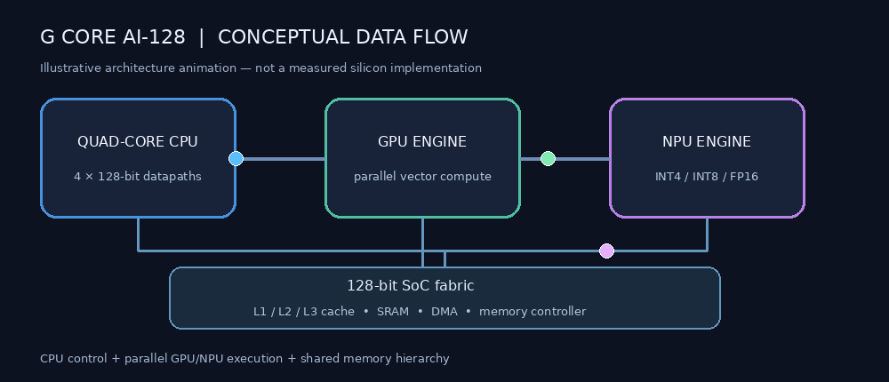
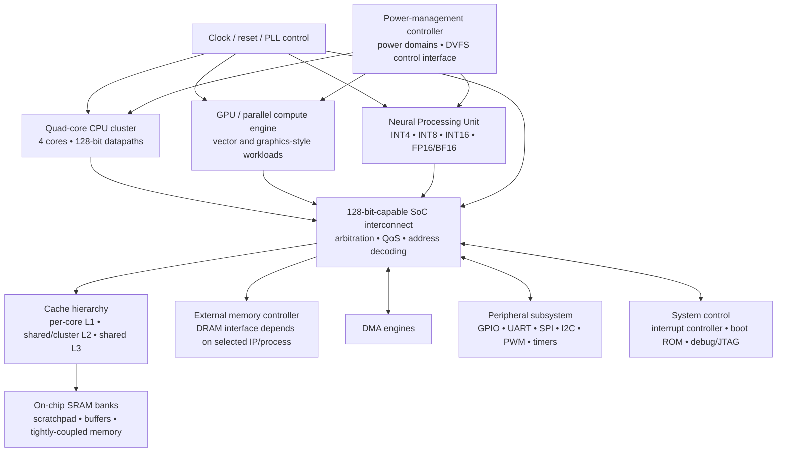
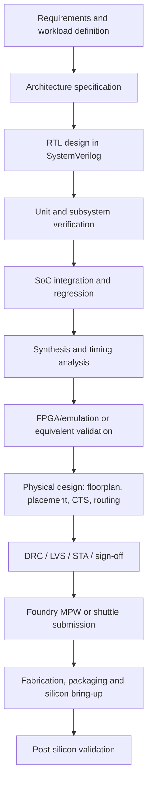

# G Core AI-128 SoC

> **Project status: Architecture proposal / pre-RTL specification.**  
> G Core AI-128 is a proposed single-die heterogeneous System-on-Chip (SoC) combining a quad-core CPU cluster, GPU-style parallel compute, a neural processing unit (NPU), cache hierarchy, on-chip SRAM, memory interfaces, and system peripherals.



The animation is an illustrative data-flow concept. It is **not** a simulation, benchmark, completed RTL design, or claim that the chip has been fabricated.

---

## 1. Project vision

The goal is to develop a custom SoC under the name **G Core AI-128**. The long-term target is a single silicon die with:

- Four CPU cores.
- 128-bit CPU datapaths and a defined 128-bit system data path.
- GPU-style parallel/vector processing.
- A dedicated NPU for neural-network workloads.
- L1, L2, and L3 cache hierarchy.
- On-chip SRAM and external-memory controller.
- GPIO, UART, SPI, I2C, timers, DMA, interrupts, debug, and boot control.
- Clock generation/distribution and power-management control.
- A target operating-frequency ambition of **1–2 GHz**, subject to process-node, timing, power, and physical-design feasibility.

**Important:** 128-bit datapath width does not automatically make a processor faster. Performance depends on clock frequency, instruction-level parallelism, number of execution units, memory bandwidth, cache behavior, software, and power/thermal limits.

## 2. Proposed top-level architecture



### Proposed processing flow

1. Software is loaded by the boot subsystem.
2. The CPU fetches and executes instructions.
3. CPU cores use their L1 caches and the shared cache/memory subsystem.
4. Parallel workloads can be submitted to the GPU engine.
5. Neural-network operators can be submitted to the NPU.
6. DMA transfers data between memory and compute engines with reduced CPU involvement.
7. Interrupts report completion and faults to the CPU.
8. Clock and power controllers manage operating states.

## 3. Functional block specification

| Block | Proposed function | Design notes |
|---|---|---|
| CPU cluster | General-purpose control and execution | 4 cores; 128-bit datapath target |
| CPU ISA | Instruction set | Must be specified; custom ISA requires assembler/compiler/toolchain work |
| ALU | Integer arithmetic and logic | Add/subtract, shifts, compare, bitwise operations |
| Register file | CPU architectural state | Width and register count defined by ISA |
| GPU engine | Parallel/vector workloads | Initial scope should be a small programmable SIMD/vector engine |
| NPU | Matrix/tensor operations | INT4/INT8 first; optional INT16, FP16/BF16 subject to area |
| L1 cache | Low-latency per-core instruction/data access | Capacity and associativity TBD |
| L2 cache | Cluster-level cache | Shared or banked architecture TBD |
| L3 cache | Last-level shared cache | Area-intensive; size TBD |
| SRAM | On-chip working memory | Capacity must be selected after area/power analysis |
| Memory controller | External DRAM access | Requires a process-compatible PHY/interface IP |
| Interconnect | Connect compute, memory, and peripherals | Address map, arbitration, bandwidth, QoS |
| DMA | Bulk data movement | Descriptor-based channels proposed |
| GPIO | Digital input/output | Pin count and voltage standards TBD |
| UART | Serial console / peripheral link | Baud-rate generator and FIFOs |
| SPI | High-speed serial peripheral bus | Controller mode initially |
| I2C | Low-speed peripheral bus | Controller mode initially |
| Timers/PWM | Timing and waveform generation | Multiple channels proposed |
| Interrupt controller | Prioritized interrupt delivery | Per-core routing to be specified |
| Boot ROM | Initial boot code | Immutable boot and recovery flow |
| Debug/JTAG | Bring-up and debugging | Access/security policy required |
| Clock/reset | Clock tree control and reset sequencing | PLL is process/IP dependent |
| PMU | Power-domain sequencing and control | External regulators still supply board power |

## 4. 128-bit design interpretation

In this project, **128-bit** is a design target for datapaths and selected internal interfaces. It does not by itself define the complete CPU architecture.

The specification must separately define:

- Register width.
- Integer ALU width.
- Load/store width.
- Address width and virtual/physical memory model.
- Instruction encoding and instruction width.
- Vector/SIMD lane organization.
- Interconnect data width.
- NPU accumulator and tensor data formats.

A 128-bit datapath may process narrower AI formats efficiently. For example, a 128-bit vector can contain 16 × INT8 values or 32 × INT4 values. Actual throughput depends on the number of arithmetic lanes and operations completed per cycle.

## 5. Memory architecture

The proposed hierarchy is:

```text
CPU core 0 ─ L1 I-cache + L1 D-cache ┐
CPU core 1 ─ L1 I-cache + L1 D-cache ├─ L2 ─ L3 ─ SoC fabric
CPU core 2 ─ L1 I-cache + L1 D-cache ┤                 │
CPU core 3 ─ L1 I-cache + L1 D-cache ┘                 ├─ SRAM banks
GPU local/shared buffers ──────────────────────────────┤
NPU local/shared buffers ──────────────────────────────┤
                                                      └─ DRAM controller
```

Cache capacities, SRAM size, cache-line size, coherence protocol, ECC/parity, and memory bandwidth are **not yet frozen**. They must be selected after workload analysis and process/IP feasibility review.

Large on-chip RAM is expensive in silicon area. A practical SoC may integrate SRAM and a DRAM controller while using external DRAM chips for large-capacity memory. The external memory chip would be separate from the G Core die.

## 6. NPU proposal

The NPU should be a dedicated accelerator rather than relying on a wide CPU alone.

Initial proposed features:

- Matrix multiplication engine.
- Multiply-accumulate (MAC) arrays.
- INT8 and INT4 execution modes.
- Accumulation with suitable wider intermediate precision.
- Local SRAM/scratchpad buffers.
- DMA access to system memory.
- Programmable operator sequencing.
- Optional FP16/BF16 support after area and timing analysis.

The number of MAC units, array dimensions, peak TOPS, and supported model sizes must not be advertised until the architecture is simulated and measured.

## 7. GPU proposal

For the first design revision, define the GPU as a compact parallel/vector compute engine. A complete modern graphics GPU would require a much larger software and hardware scope.

Potential blocks:

- Vector execution lanes.
- Integer and floating-point arithmetic units.
- Register file.
- Work scheduler.
- Local/shared memory.
- DMA and interrupt interface.

A graphics pipeline (rasterizer, texture units, display controller, etc.) is optional and should be treated as a later revision unless graphics output is a confirmed requirement.

## 8. System peripherals and control

Proposed peripheral list:

- GPIO.
- UART.
- SPI.
- I2C.
- PWM.
- General-purpose timers and watchdog.
- DMA.
- Interrupt controller.
- Boot ROM.
- JTAG/debug interface.
- External memory controller.
- Clock and reset controller.
- Power-management controller.

**Power note:** A PMU can be integrated as control logic, but board-level voltage regulators, power stages, inductors, and power connectors generally remain external. PLLs and high-speed PHYs may require foundry-qualified IP.

## 9. Target specifications — not yet frozen

| Parameter | Current target | Status |
|---|---|---|
| Product name | G Core AI-128 | Selected |
| Integration | Single-die SoC | Target |
| CPU cores | 4 | Proposed |
| CPU datapath | 128-bit | Requested target |
| GPU datapath | 128-bit-oriented | Proposed |
| NPU datapath | 128-bit-oriented | Proposed |
| AI formats | INT4 / INT8; optional INT16, FP16/BF16 | Proposed |
| Cache | L1 + L2 + L3 | Requested |
| On-chip RAM | High-capacity SRAM | Capacity TBD |
| Clock | 1–2 GHz | Ambitious target; process-dependent |
| GPIO and serial interfaces | GPIO, UART, SPI, I2C | Proposed |
| Process node | To be selected with foundry | TBD |
| Package | To be selected | TBD |
| Power envelope | To be estimated | TBD |

No transistor count, die size, power consumption, TOPS, or achievable clock rate is claimed at this stage.

## 10. Development methodology



### Recommended open-source tools

| Tool | Purpose |
|---|---|
| Verilator | RTL simulation and linting |
| Icarus Verilog | Verilog simulation |
| GTKWave | Waveform inspection |
| Yosys | Logic synthesis |
| OpenROAD | RTL-to-GDS physical-design flow |
| KLayout | Layout viewing and inspection |
| Magic | Layout and design-rule workflows where supported |
| cocotb | Python-based verification |
| GitHub Actions | Automated lint/simulation tests |

Tool compatibility depends on the selected process design kit (PDK). A successful open-source flow is not automatically foundry sign-off.

## 11. Repository structure

A proposed repository layout:

```text
g-core-ai128/
├── README.md
├── LICENSE
├── CONTRIBUTING.md
├── docs/
│   ├── architecture.md
│   ├── cpu-isa.md
│   ├── memory-map.md
│   ├── cache-design.md
│   ├── gpu-spec.md
│   ├── npu-spec.md
│   ├── peripheral-spec.md
│   ├── clock-reset.md
│   ├── power-management.md
│   ├── verification-plan.md
│   └── fabrication-plan.md
├── rtl/
│   ├── cpu/
│   ├── gpu/
│   ├── npu/
│   ├── cache/
│   ├── memory/
│   ├── interconnect/
│   ├── peripherals/
│   └── soc_top.sv
├── tb/
│   ├── unit/
│   ├── subsystem/
│   └── soc/
├── sim/
├── constraints/
├── physical/
│   ├── floorplan/
│   ├── pinout/
│   └── signoff/
├── scripts/
├── assets/
│   └── gcore-dataflow.gif
└── .github/
    └── workflows/
```

Directories are a proposed organization; modules and implementation files will be added as the design is developed.

## 12. Verification and acceptance criteria

Before a fabrication submission, the project should demonstrate:

- CPU instruction tests pass.
- Reset and boot sequence works.
- Register and ALU tests pass.
- Cache and memory tests pass.
- Interconnect arbitration and error handling are verified.
- DMA transfers are verified.
- Peripheral register and protocol tests pass.
- GPU/NPU arithmetic tests match reference models.
- Clock-domain crossings and reset-domain behavior are checked.
- Synthesis, timing, DRC, and LVS requirements are satisfied for the chosen PDK.
- Foundry-qualified IP licenses and integration requirements are resolved.

## 13. Fabrication and cost reality

The first G Core AI-128 design is much larger than a small student microcontroller. A full quad-core CPU + GPU + NPU + large SRAM + three cache levels + 1–2 GHz target is not a realistic ₹5,000–₹14,000 custom-silicon commitment.

The project should first obtain written quotations for:

1. Design/verification support, if outsourced.
2. Foundry process and MPW shuttle participation.
3. PDK/IP access and licensing.
4. Physical-design and sign-off services.
5. Package, assembly, and test.
6. Shipping, taxes, and contingency.

An MPW run shares a wafer with other designs; it is not the same as ordering a dedicated wafer. Eligibility, die area, number of packaged samples, and delivery date depend on the programme.

Potential India route to investigate: C-DAC ChipIN / C2S and SCL Mohali. Participation and subsidies are subject to programme rules and institutional eligibility. No fabrication slot or subsidy is assumed by this README.

## 14. Project roadmap

| Phase | Deliverable | Exit condition |
|---|---|---|
| P0 | Requirements freeze | ISA, memory, interfaces, workloads defined |
| P1 | Architecture specification | Block interfaces and address map reviewed |
| P2 | CPU RTL | Unit tests and instruction tests pass |
| P3 | Memory/interconnect RTL | Arbitration and memory tests pass |
| P4 | GPU/NPU RTL | Reference-model tests pass |
| P5 | Full SoC verification | Regression suite passes |
| P6 | PDK-specific physical design | Timing/DRC/LVS sign-off |
| P7 | MPW submission | Foundry/programme accepts tape-out |
| P8 | Silicon bring-up | Packaged samples pass validation |

## 15. Open decisions

These decisions must be resolved before the architecture can become implementation-ready:

- Is the CPU instruction set custom, or based on an existing open ISA?
- Does “128-bit” mean 128-bit registers, ALU, addresses, interconnect, or all of these?
- What are the required L1/L2/L3 and SRAM capacities?
- Is external DRAM required? Which standard and bandwidth?
- Is the GPU intended for graphics, general parallel compute, or both?
- Which NPU data formats and model workloads are mandatory?
- What package, pin count, I/O voltage, and power envelope are required?
- Which PDK and foundry programme can accept the design?

## 16. Disclaimer

G Core AI-128 is currently a concept and proposed architecture. It is not yet a completed processor, verified RTL implementation, tape-out-ready GDSII, or fabricated product. All performance, frequency, area, power, cost, and delivery claims require implementation, verification, process selection, and foundry confirmation.

---

## Project identity

**Name:** G Core AI-128  
**Type:** Custom heterogeneous AI System-on-Chip  
**Integration goal:** Single silicon die  
**Current phase:** Requirements and architecture definition  
**Long-term goal:** Fabricated and validated custom silicon
